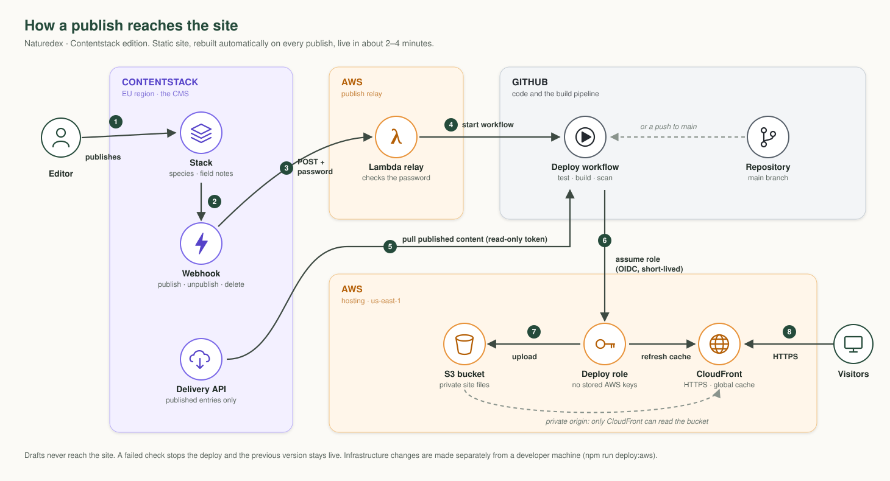
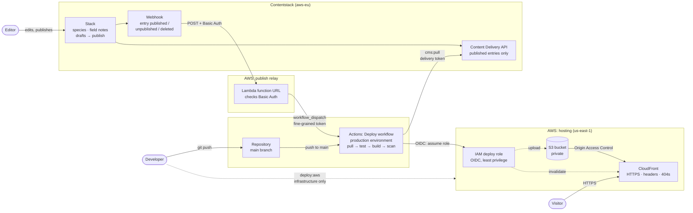
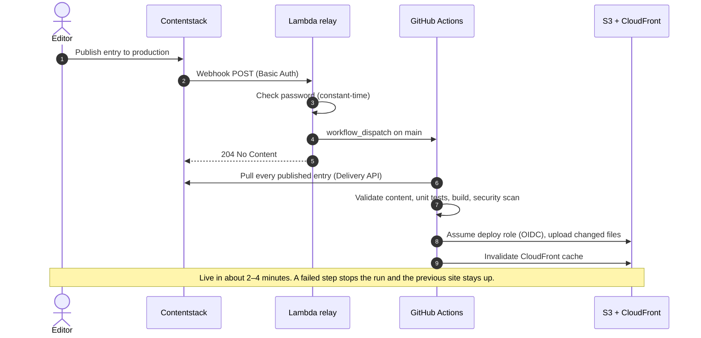

# Architecture

Naturedex is a static site. Contentstack holds the content, GitHub Actions turns published content into HTML, and AWS serves the result. Visitors' browsers never contact Contentstack, GitHub or the AWS APIs. They only fetch files from CloudFront.

## System overview

## What happens when an editor publishes

## Components

| Part | What it does | Defined in |
| --- | --- | --- |
| Contentstack stack | Content types `species` and `blog_post`, 24 species, field notes, drafts, roles and publishing | `contentstack/content-types/` |
| Content pull | Fetches all published entries, validates them, writes `data/content.json` atomically | `scripts/contentstack/pull.ts`, `src/lib/contentstack.ts` |
| Static site | Astro renders every route to HTML. React islands add filtering, the map, dialogs and local discoveries. | `src/` |
| Status page | `/status/` is generated at build time with the content source, counts, test totals and app version | `src/lib/status.ts`, `src/components/SystemStatus.tsx` |
| Hosting | Private S3 bucket behind CloudFront: HTTPS only, security headers, directory indexes, real 404s | `infra/aws.yaml` |
| Webhook relay | Lambda function URL. Turns a Contentstack webhook into a GitHub workflow run. Forwards nothing from the payload. | `infra/publish-relay.js` → `infra/publish.yaml` |
| Deploy role | Assumed by GitHub through OIDC. Can only read the site stack's outputs, write to its bucket and invalidate its distribution. | `infra/publish.yaml` |
| Deploy workflow | Pull → test → build → scan → upload → invalidate, one run at a time | `.github/workflows/deploy.yml`, `scripts/deploy-aws.sh` |

## Where credentials live

| Credential | Stored in | Used by | Can do |
| --- | --- | --- | --- |
| Delivery token + API key | GitHub `production` environment secrets, local `.env` | Deploy workflow, `cms:pull` | Read published content |
| Management token | Local `.env` only | `cms:import` | Create content types and entries. Never sent to GitHub or AWS. |
| Fine-grained GitHub token | Lambda environment (encrypted) | Relay | Start workflows in this repository only |
| Webhook password | Lambda environment, Contentstack webhook | Relay | Start a deploy |
| AWS credentials | None stored. GitHub gets short-lived ones through OIDC. | Deploy workflow | Upload and invalidate this site only |

## Design choices

- **Static output instead of a server.** The site has no server to patch or scale, and it costs effectively nothing. The trade-off is that changes appear after a rebuild (2–4 minutes), not instantly. Previewing drafts would need Contentstack Live Preview and a server-rendered preview site, which this setup does not have.
- **A relay instead of calling GitHub directly.** Contentstack webhooks can't send the request body GitHub's API requires, so a small Lambda function translates between them.
- **Content changes and infrastructure changes are separate.** CI can update the site's files. Only a developer running `npm run deploy:aws` can change the AWS infrastructure.
- **Failed builds never go live.** Every check runs before the upload, so the previous version stays online if anything fails.
